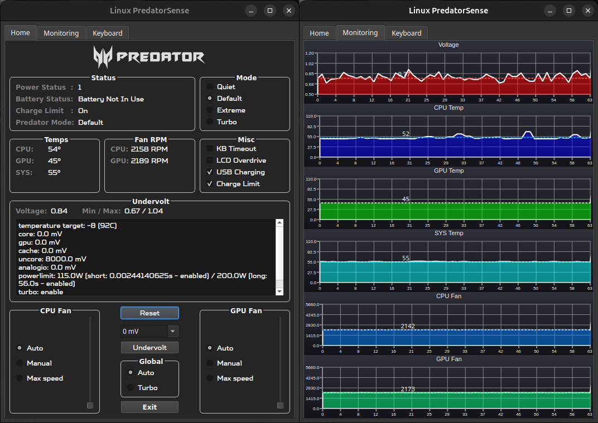

## PredatorSense™ / NitroSense™ clone for Acer Predator & Nitro laptops
### Controls fan speed, gaming modes and undervolting on Linux. The app detects your machine at startup (DMI product name) and loads the matching EC register map, so one install works on both Predator and Nitro machines with Intel or AMD CPUs.

## Supported devices:
* Predator Helios 300 (2021) ```PH315-54``` — verified
* Predator Helios 300 (2018-2020) ```PH315-5x / PH317-5x``` — untested
* Nitro 5 ```AN515-44/45/46/53/54/55/56/57/58, AN517-55```
* Intel CPUs: VCore monitoring + undervolt via ```undervolt``` (pure Python, no msr-tools)
* AMD CPUs: VCore monitoring + undervolt via ```amdctl``` (must be on PATH)




## Disclaimer:
* Secure Boot **IS** \* supported if you only use the ```acpi_ec``` or ```ec_sys``` package for EC access (both are kernel modules; ```ec_sys``` ships in-tree).
* Secure Boot is **NOT** \* supported if you want to control CPU voltage offsets using the ```undervolt``` (Intel) or ```amdctl``` (AMD) package.
* Using this application with other laptops may potentially damage them. Proceed at your discretion.

## Install:
- From the command line
```
git clone https://github.com/snowyoneill/Linux-PredatorSense/
cd Linux-PredatorSense/
``` 

## Usage:
### COMMAND LINE  
 - ```sudo``` is required in order to access the Super I/O EC registers and apply undervolt offsets.
  - From the command line run the main script as root (```-E``` keeps your user environment so fonts and the venv stay visible to root):
  ```
  sudo -E python3 main.py
  ```

### PREVIEW MODE
 - To see how the app looks and behaves on a different supported model, pass ```--preview```. The UI is driven by a simulated EC seeded from that model's register map, so no real registers are touched and no root is needed:
  ```
  python3 main.py --preview "Nitro AN515-55"
  ```
  On a Nitro the Predator-only controls (Turbo mode, LCD Overdrive) are hidden automatically. Add ```--dump``` to print the resulting widget state and exit, which is handy for quick checks.

_[OPTIONAL - undervolt only]_
- **Intel** undervolting uses the [undervolt](https://github.com/georgewhewell/undervolt) package. Install it into the same venv the app runs from:
  ```
  ./venv/bin/pip install git+https://github.com/georgewhewell/undervolt.git
  ```
  ```core/intelctl.py``` resolves ```UNDERVOLT_PATH``` to that venv automatically and runs it with ```sys.executable```, so it works under ```sudo``` without a system-wide install and you do **not** need ```which undervolt``` to point anywhere.
- **AMD** undervolting uses [amdctl](https://github.com/kevinlekiller/amdctl), a small C program (no pip). Build it and install it somewhere on **root's** PATH (the app runs it as a bare `amdctl` under `sudo`); `/usr/local/bin` works on most distros:
  ```
  sudo apt install build-essential   # amdctl is a C program; needs gcc/make to build
  git clone https://github.com/kevinlekiller/amdctl.git
  cd amdctl && make
  sudo cp amdctl /usr/local/bin/ && sudo chmod +x /usr/local/bin/amdctl
  sudo modprobe msr   # amdctl needs the msr module; the app passes -m to allow MSR writes on kernel 5.9+
  ```
  Verify with `sudo amdctl -g -c0` (prints the current P-state voltages). See the AMD section below for which CPU families amdctl supports.
- Pick your offset in the app's offset box (20 mV presets, or type any exact value like ```-85 mV```, 0 to -700 mV) and click ```Undervolt```. Find your stable value gradually with throttlestop on Windows or a Linux stress test; offsets live in MSRs and reset on reboot.

### UNDERVOLT SUPPORT BY CPU GENERATION
Whether you can *apply* an undervolt, and whether the live VCore readout works, depends heavily on the CPU generation. Intel has progressively locked the voltage-offset MSRs (the Plundervolt mitigations), so this is not a software limitation of the app.

| CPU generation | Apply undervolt | VCore readout (MSR 0x198) |
|---|---|---|
| 6th–9th gen (Skylake → Coffee Lake) | Usually works out of the box, or after enabling an "Overclocking / Voltage Control" option in BIOS | Works |
| 10th gen (Comet Lake) | Often locked by microcode; may need a BIOS with the lock disabled | Works |
| 11th gen H45 (Tiger Lake-H, e.g. i7-11800H) | **Locked by default** — must disable the "Overclocking Lock" BIOS variable first (see below) | Works |
| 12th gen+ (Alder Lake, Raptor Lake, …) | **Not supported** — Intel removed/locked the offset MSRs; `undervolt` cannot write them | Unreliable — 0x198 may return 0 or a stale value on recent client parts |

If your machine is 12th gen or newer, expect the Undervolt feature to be unavailable; the fan/mode controls still work.

#### Unlocking undervolt on 11th-gen H45 (Tiger Lake-H) Nitro 5 / Helios 300
On 11th-gen H45 parts (11980HK / 11900H / 11800H / 11400H) the offset MSRs are gated by an "Overclocking Lock" bit in the InsydeH2O BIOS. It can be flipped without a modded BIOS using the InsydeH2O `H2OUVE` console tool from Windows. This is the procedure used to unlock an i7-11800H.

> **Warning:** always dump and edit a **fresh** `vars` file. Variable order can change between boots, and flashing vars from a previous session or an older BIOS can **brick the laptop**. A BIOS update re-locks undervolt, so this must be redone after every BIOS update.

1. In BIOS (Boot menu), set **Secure Boot → Disabled** (you may need to set a BIOS admin password first if the option is greyed out).
2. In Windows, extract the InsydeH2O `H2OUVE-W-CONSOLEx64.exe` tool to a folder (e.g. `C:\insyde-tool`) and open an **Administrator** `cmd.exe` there.
3. Dump the current variables: `H2OUVE-W-CONSOLEx64.exe -gv vars.txt`
4. Open `vars.txt`, find the `CpuSetup` block, and change the Overclocking-Lock byte from `01` to `00`. On the Nitro 5 (11th gen) that byte is at offset **0xDF** (the Helios 300 2021 uses **0xDA**); note the `[05B]`-style variable index shown next to it.
5. Save as `vars-m.txt` and flash it back: `H2OUVE-W-CONSOLEx64.exe -sv vars-m.txt`
6. Reboot. Success prints `Variable Index[05b]: Set Successfully`. Undervolt should now apply from the app.

Full original guide (with screenshots and a video) by **u/dglt1**: [*"Unlock Undervolting on 11th Gen (H45) Nitro 5 Within Minutes"*](https://www.reddit.com/r/AcerNitro/comments/qvznen/unlock_undervolting_on_11th_gen_h45_nitro_5/) on r/AcerNitro. H35 parts (11300H / 11370H) are **not** covered by that method.

#### AMD (via amdctl)
AMD has **not** hardware-locked undervolting the way Intel did, but this app applies AMD offsets through [amdctl](https://github.com/kevinlekiller/amdctl), which writes the legacy P-state VID MSRs and supports CPU families **10h–19h** — K10 (2007) through **Zen 3 (Ryzen 5000 series and older)**.

| AMD generation | Undervolt via this app |
|---|---|
| Zen / Zen+ / Zen 2 (Ryzen 1000–4000) | Works (family 17h) |
| Zen 3 (Ryzen 5000) | Works (family 19h) |
| Zen 4 / Zen 5 (Ryzen 6000+) | **Not supported by amdctl** — the tool does not implement the newer interface |

Two notes:
- On kernels 5.9+, userspace MSR writes are restricted by default. amdctl lifts this with its `-m` flag, which the app already passes on every call — no extra setup needed.
- Zen 4/5 silicon *does* support undervolting, but through the SMU-based **Curve Optimizer** (PBO) — a different mechanism amdctl does not implement. On Windows that is reachable with tools like Universal x86 Tuning Utility or G-Helper; there is no equivalent wired into this app on Linux yet.

### ICON
 - The window icon and title follow the detected machine: Predator machines get ```assets/predatorsense.ico``` and the title ```Linux PredatorSense```, Nitro machines get ```assets/nitrosense.ico``` and ```Linux NitroSense```.
 - Two ```.desktop``` templates ship with the repo: ```predator-sense.desktop``` (```StartupWMClass=Linux PredatorSense```) and ```nitrosense.desktop``` (```StartupWMClass=Linux NitroSense```). The Ubuntu/GNOME dock matches a running window to a ```.desktop``` file via ```StartupWMClass```, which must equal the window title the app sets — so install the one matching your machine (or both) for the dock to show the right icon. Icons are PNG (```assets/*.png```), the preferred icon format on Linux; the ```.ico``` files remain for the in-app window icon and Windows-style packaging.
 - Alternatively you can copy the .desktop file to your applications folder and launch the program via it's icon.
  - Open ```predator-sense.desktop``` (or ```nitrosense.desktop```) in a text editor.
  - Set ```<path_to_PredatorSense>``` to the directory where you downloaded this project.
  ```
  Exec=sh -c "pkexec env DISPLAY=\$DISPLAY XAUTHORITY=\$XAUTHORITY sh -c 'cd <path_to_PredatorSense> && python3 main.py'"
  Icon=<path_to_PredatorSense>/assets/predatorsense.png
  ```
  - Copy the file to the application directory
  ```
  sudo cp predator-sense.desktop /usr/share/applications/
  ```
  - Now launch via the application and on initialization it will prompt for the user password.

### NVIDIA-POWERD
- After switching predator modes \* **YOU MAY NEED TO RESTART NVIDIA-POWERD SERVICE IN ORDER TO DETECT NEW TGP** \*
```
sudo systemctl restart nvidia-powerd
``` 
- You can check the current GPU TGP via
```
nvidia-smi
```

## Dependencies:
* Ubuntu / Linux Mint:
  ```
  sudo apt-get install python3-pyqt5 python3-pyqt5.qtchart
  ```

  The app needs a writable EC node and tries them in this order, so set up **one** of the two options below:

  - **Option A — `ec_sys` (ships with the kernel, nothing to install — just load it):**
  ```
  sudo modprobe ec_sys write_support=1
  sudo cat /sys/kernel/debug/ec/ec0/io > /dev/null #confirm access to EC
  ```
  `write_support` defaults to `0`, which exposes the register file read-only, so it must be passed at load time. To change it on a system where the module is already loaded, unload it first (`sudo rmmod ec_sys`).

  To make it permanent, edit `/etc/default/grub` and add `ec_sys.write_support=1` to `GRUB_CMDLINE_LINUX_DEFAULT`, then regenerate the grub config:
  ```
  sudo nano /etc/default/grub
  # GRUB_CMDLINE_LINUX_DEFAULT="quiet splash ec_sys.write_support=1"
  sudo update-grub        # Fedora: sudo grub2-mkconfig -o /boot/grub2/grub.cfg
  ```

  - **Option B — `acpi_ec` (DKMS, exposes `/dev/ec`):**
  ```
  git clone https://github.com/musikid/acpi_ec/
  cd acpi_ec
  sudo ./install.sh
  modprobe acpi_ec
  sudo cat /dev/ec #confirm access to EC
  ```

  ```
  [OPTIONAL]
  pip install git+https://github.com/georgewhewell/undervolt.git
  sudo modprobe msr # VCore monitoring and undervolt access MSRs via /dev/cpu/*/msr
  ```
* Fedora:
  ```
  sudo dnf install python3-qt5
  sudo dnf install python3-pyqtchart
  ```

  ```
  sudo dnf install dkms
  
  git clone https://github.com/musikid/acpi_ec/
  cd acpi_ec
  sudo ./install.sh
  modprobe acpi_ec
  sudo cat /dev/ec #confirm access to EC
  ```

  ```
  [OPTIONAL]
  pip install git+https://github.com/georgewhewell/undervolt.git
  sudo modprobe msr # VCore monitoring and undervolt access MSRs via /dev/cpu/*/msr
  ```

Packages:
* ```Python Qt5``` -> [PyQt5](https://pypi.org/project/PyQt5/)
* ```acpi_ec``` -> [acpi_ec by musikid](https://github.com/musikid/acpi_ec/)
* ```undervolt``` -> [Undervolt by georgewhewell](https://github.com/georgewhewell/undervolt)
* ```amdctl``` -> [amdctl by kevinlekiller](https://github.com/kevinlekiller/amdctl)

## This is a fork of [PredatorSense by mohsunb](https://github.com/mohsunb/PredatorSense), customized for ```PH315-54```

## Changelog:

Oct 13, 2026

main.py / ui/frontend.py
- The Offset selector moved out of the Undervolt box into the middle column, directly above the ```Undervolt``` button, so the value and the action are adjacent. The ```Offset:``` label was dropped since each item reads e.g. ```-140 mV```.
- The Offset selector is now **editable**: pick a 20 mV preset from the list or type any exact value (e.g. ```-85 mV```) for fine-grained offsets between the presets. A validator restricts input to a signed 3-digit mV value, and the value is clamped to 0..700 mV before it reaches the MSR. The combo and its dropdown popup are styled to match the dark theme.
- ```Reset``` now also moves the dropdown back to ```0 mV``` (```resetUndervolt```) so the widget reflects the offset actually applied, instead of leaving a stale value shown.
- Mode and Misc boxes are more compact: the radios/checkboxes are capped at 20px tall with 1px row spacing, freeing vertical space for the Undervolt box.
- The Reset / Undervolt / Global / Exit controls in the middle column are set to a fixed width (2/3 of the column) and centered, with whitespace on either side, instead of stretching the full column width.

Oct 12, 2026

main.py / assets/
- Brand-aware chrome: the window title and icon now follow the detected machine series. Predator machines run as ```Linux PredatorSense``` with ```assets/predatorsense.ico```; Nitro machines run as ```Linux NitroSense``` with ```assets/nitrosense.ico```. Resources are resolved through a ```resource_path()``` helper so they also work from a PyInstaller bundle.
- Keyboard RGB fixes (```utils/keyboard.py```, ```ui/frontend.py```): the ```facer``` driver expects brightness 0-100 and speed 0-9, but the ported UI used 1-10 sliders, so the keyboard ran at ~10% brightness. Static mode also ignored the brightness slider entirely (```payload[2]``` was hardcoded to 0), and the direction labels were swapped relative to the driver (```1``` = right to left). Payloads now match ```facer_rgb.py``` byte for byte. Re-apply any previously saved ```rgb.conf``` values, since old 1-10 brightness values now mean 1-10%.
- Preview mode now shows the Keyboard tab: ```utils/keyboard.py``` gained a ```DRY_RUN``` flag (set automatically under ```--preview```) that prints the payloads instead of writing to ```/dev/acer-gkbbl-*```, and preview RGB settings save to the preview cache instead of /etc.
- Fixed Global "Turbo" (max fan speed) radio being hidden on Nitro previews: only the Turbo *power mode* radio is Predator-only; the fan turbo exists on all models.
- Undervolt dropdown now steps in 20 mV (0 to -700) instead of 100 mV, so common sweet spots like -80 mV are selectable. The old ```COREOFFSET```/```CACHEOFFSET``` constants were dead code (never read) and have been removed from ```main.py```, ```core/intelctl.py``` and ```core/amdctl.py```; the dropdown is the single source of truth.
- Home tab layout fixes: the ```PREDATOR``` logo is back above the Status box (the rewrite from fixed geometry to layouts had dropped it, since the original drew ```PredatorLogo.png``` as a tab background). It now ships as ```assets/predator_logo.png``` in a centered label, and is omitted on Nitro machines, which have no logo. Values in the Temps and Fan RPM boxes are centered under their titles instead of pushed to the right edge, and the Auto/Manual/Max speed radios in the CPU/GPU fan boxes are vertically centered in their borders. The window has a fixed minimum size (```520x720```): the centered box values would slide under their labels if a box got too narrow, and the Undervolt box needs the height for its status text. The three grid columns now share surplus width evenly, so the CPU and GPU fan boxes resize together.

Oct 11, 2026

main.py
- Voltage monitoring now reads MSR 0x198 directly via /dev/cpu/*/msr in Python; msr-tools is no longer required. If the MSR module is not loaded, the voltage update is skipped instead of crashing.
- Fixed LCD overdrive toggle: register 0x21 is shared with the GPU fan mode (upper nibble). The toggle now re-reads the register and uses bitwise set/clear on bit 3 instead of +/-, which could corrupt the fan mode (e.g. 0x50 - 0x08 = 0x48).
- Fixed GPU fan mode detection: mode comparisons now mask off bit 3, so overdrive being on no longer triggers "Unknown GPU fan mode" warnings.
- Undervolt integration: UNDERVOLT_PATH resolves to the local venv automatically and the undervolt commands run with sys.executable, so they work under sudo without a system-wide python.
- Multi-device support: the app now detects the machine via the DMI product name at startup and loads the matching EC register map, so a single install supports both Predator and Nitro laptops (Intel and AMD).
- Constructor split into _initialize_variables / _initialize_ec_handler / _initialize_ui for readability.
- Settings persistence: fan modes, power mode and toggles are saved to /etc/predatorsense/predatorsense.conf on every change and re-applied to the EC at startup.
- Ctrl-C now triggers a graceful shutdown that closes the EC file handle before exiting.
- Added a ```--preview "<model>"``` flag that renders the UI for any supported model using a simulated EC, so other machines' layouts can be checked without root or touching real registers. ```--dump``` prints the resulting widget state and exits.

core/device_regs.py
- New module holding the per-model EC register maps (Predator PH315-54, Helios 300 family, Nitro AN515-44/46) plus device and CPU-vendor detection. Detection reads /sys/class/dmi/id/product_name and /proc/cpuinfo directly, so no dmidecode dependency is needed.
- Per-device capability flags (gpu_mode_mask, has_turbo_mode, has_turbo_led, has_lcd_overdrive, has_trackpad_status) let the app adapt its features per machine.

core/intelctl.py
- Intel voltage monitoring and undervolt integration moved out of main.py. Voltage is read from MSR 0x198 via /dev/cpu/*/msr in pure Python (no rdmsr/msr-tools).

core/amdctl.py
- New AMD support: VCore monitoring and undervolting via the amdctl utility, selected automatically on AMD machines.

core/commandrunner.py
- New QProcess wrapper that accumulates command output and emits it on completion, replacing the per-call QProcess boilerplate.

ui/frontend.py
- Predator-only widgets (Turbo mode, LCD Overdrive) are hidden automatically on devices that do not have those registers.
- Rebuilt the UI with Qt layouts (grid/form/box) instead of absolute pixel geometry, so the window is resizable and adapts to the font/DPI of the machine.
- Undervolt offset is now selected from a dropdown (0 to -700 mV) instead of being hardcoded in source.
- Added a Keyboard tab for RGB backlight effects (static colour per zone, breath, neon, wave, shifting, zoom). It only appears when the kernel exposes the acer-gkbbl devices, and its settings persist to rgb.conf.

.github/workflows/python-app.yml
- Added CI that lints, byte-compiles and builds the PyInstaller binary on every push/pull request, uploading the binary as an artifact.

Mar 12, 2024

ecwrite_py
- If access to the EC cannot be obtained then the app will now shutdown.

frontend.py
- Bug fix, cast tick internal value to int.

main.py
- If an empty string is returned when querying the voltage, skip updating. Prevents crashes when msr-tools is not installed.

- Updated README to add more documentation on installation.

Mar 11, 2024

ecwrite.py
- Updated EC class to point to acpi_ec path ( /dev/ec ) instead of the default ( /sys/kernel/debug/ec/ec0/io ) which no longer is supported in Ubuntu.
- Optimized code to use a buffer to store the contents of the EC register. Load once and read multiple times per update cycle.
Added exception handling.

frontend.py
- Added a new monitoring tab to display the last 60 seconds of recorded voltage, temps and fan speed sensors.
- Created a new custom chart class for modularity.
- Increased the height of widget to accommodate new charts.

main.py
- Removed global min and max voltage readings.
- Changed the voltage reading to be an average of all the cores rather than core 0.
- Optmized voltage reading by reusing the same QProcess for each update rather than creating and destroying.
- Added voltage, undervolt and min and max class variables.
- Added missing batteryChargeLimit initialization.
- Created global UPDATE_INTERVAL variable to store update fequency in ms.
- Consolidated Qt frontend updates to the updatePredatorStatus function.
- Updated shutdown to cleanly free resources.

Sep 21, 2023
- Added user toggle for charge limiting.
- Bug fix output error for unknown CPU fan mode.

Dec 22
- Completely overhauled the UI.
  - Added new Dialogs for fan speed, temperatures, modes, undervolting and miscellaneous
  - Created a new screenshot to showcase the updated interface.
- Updated app icon to blue predator logo (originally red).
- Created a new class for accessing EC registers.
  - Close file handle on shutdown.
- Created a timer to periodically update the UI.
- Created toggle for LCD Overdrive.
- Created toggle for USB charging.
- New function to check the current VCORE voltage and record max/min.
- New functions to undervolt CPU.
- New function to query battery charge limit.
- New function to query predator mode.
- New function to read fan speed.
- Lots of refactoring.
